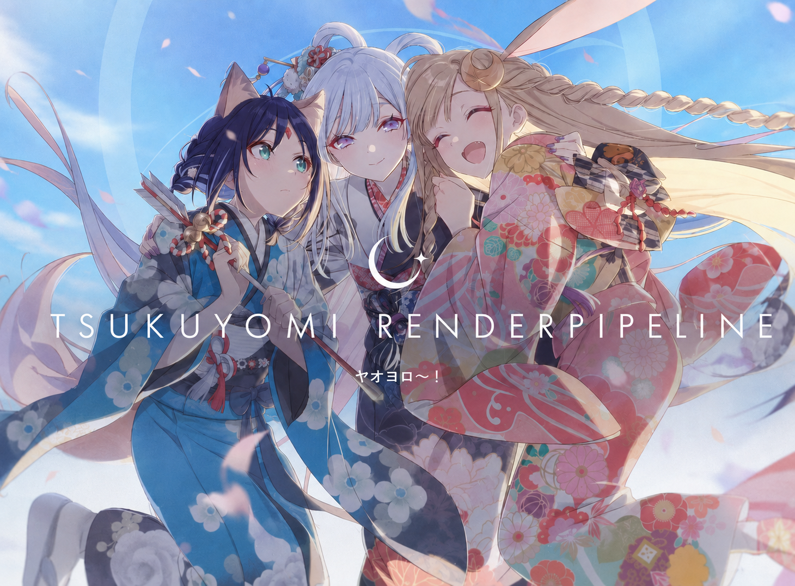

# TsukuyomiRP

TsukuyomiRP is an experimental collection of custom rendering features for Unity's Universal Render Pipeline (URP).

> [!WARNING]
> This package is under active development. APIs and rendering behavior may change between releases.

## Requirements

- Unity 6000.5 with Universal Render Pipeline 17.5, or Unity 6000.6 with Universal Render Pipeline 17.6
- Keep the URP version matched to the Unity Editor; the package retains 17.5.0 as its minimum dependency.
- Git and Git LFS for installation from a Git URL. Native plugins and sample assets are stored in Git LFS.

## Installation

In Unity, open **Window > Package Management > Package Manager**, select **Install package from git URL**, and enter:

```text
https://github.com/kx1125/TsukuyomiRP.git#v0.3.0
```

You can also add the package directly to your project's `Packages/manifest.json`:

```json
{
  "dependencies": {
    "tsukuyomi.render-pipelines.universal": "https://github.com/kx1125/TsukuyomiRP.git#v0.3.0"
  }
}
```

## Profile and Graph Editor

New `TsukuyomiPipelineProfile` assets contain no effects. Open **Graph Editor** from the Profile Inspector, double-click the desired rendering stage to add a Pass, and click **Save & Apply**. The Profile Inspector then displays only the added nodes, with their Enabled switches and parameters. Graph Editor edits remain a draft until applied; reload a draft after external Profile changes to avoid overwriting them.

Each RendererFeature owns its Pass runtime instances and camera resources. Passes prepare their settings in `PrepareRecording` and declare their dependencies and restoration steps; the Feature handles generic scheduling and lifecycle management. New Passes provide their own code and resources and are discovered automatically, without adding effect-specific fields or branches to the framework.

Settings resolve from node defaults, then checked Volume fields, then explicit camera overrides. **Enabled is the master switch:** an absent or disabled node cannot be activated by Volume or camera API overrides.

## SceneScan rendering features

SceneScan rendering is split into four independent effects. Add the corresponding Pass nodes in Graph Editor, then edit their parameters in the Profile Inspector or through the corresponding `TsukuyomiRP` Volume overrides.

| Feature | Public Pass | Responsibility |
| --- | --- | --- |
| VoxelTransition | `TsukuyomiVoxelTransitionPass` | Voxel sampling, screen expansion and distortion |
| ScanPostProcess | `TsukuyomiScanPostProcessPass` | Surface scan/grid, reveal, flash, voxel glitch, horizontal glitch and chromatic split |
| XrayRender | `TsukuyomiXrayRenderPass` | Registered renderer masks, private target depth and highlights behind walls |
| SpatialGridRender | `TsukuyomiSpatialGridRenderPass` | World-space lattice points and connecting lines |

Scan, voxel glitch, horizontal glitch and chromatic split have separate switches. Project code owns timing, curves, presets and gameplay target categories, and calls the static Pass APIs for enabled nodes directly without looking up `RendererFeature`:

```csharp
TsukuyomiSpatialGridRenderPass.SetCameraEnabled(camera, true);
TsukuyomiScanPostProcessPass.SetCameraEffectEnabled(camera, ScanPostEffect.ChromaticSplit, false);
// Return control to Profile/Volume when this camera override is no longer needed.
TsukuyomiSpatialGridRenderPass.ClearCamera(camera);
```

SpatialGridRender can run independently with full coverage; its current Mesh backend remains private so future particle or Compute Shader implementations can retain the public parameter API.

See [Scene effect APIs](Documentation~/SceneEffects.md) for coverage, animation, renderer registration, resource cleanup and execution order, and the [feature development guide](Documentation~/FeatureDevelopmentGuide.md) for custom Pass integration.

## DLSS / FSR3

The unified `Tsukuyomi Upscaler` supports switching between DLSS SR / DLAA and FSR3, with optional DLSS 5 Neural Rendering after post processing.

The Git URL above installs the complete package, including `Plugins` and `ThirdParty/UnityRHI`. Restart Unity after installation so its Windows native plugins preload. Separate `top.kuanmi.*` packages are unnecessary.

## Samples

The **LookDev** sample contains a subway scene configured to demonstrate TsukuyomiRP rendering features.

1. Open **Window > Package Management > Package Manager** and select **TsukuyomiRP**.
2. Open the **Samples** tab and import **LookDev**.
3. In the setup prompt, select **Apply and Open**.

The setup assigns the imported `SampleScene_Asset.asset` to Graphics Settings and the active Quality level, repairs APV Scene GUID references if the sample importer changed them, and opens `LookDev.unity`. If the prompt was dismissed, run **Tools > Tsukuyomi RP > Samples > Setup LookDev Sample**.

The sample render pipeline asset references its included renderer and Tsukuyomi pipeline profile. Applying it changes rendering for the current project, so restore your previous pipeline asset after evaluating the sample if necessary.

## License

This project is licensed under the [MIT License](LICENSE.md).

Bundled native libraries and third-party code retain their respective licenses; see the [third-party notices](ThirdParty/UnityRHI/ThirdPartyNotices.md).
