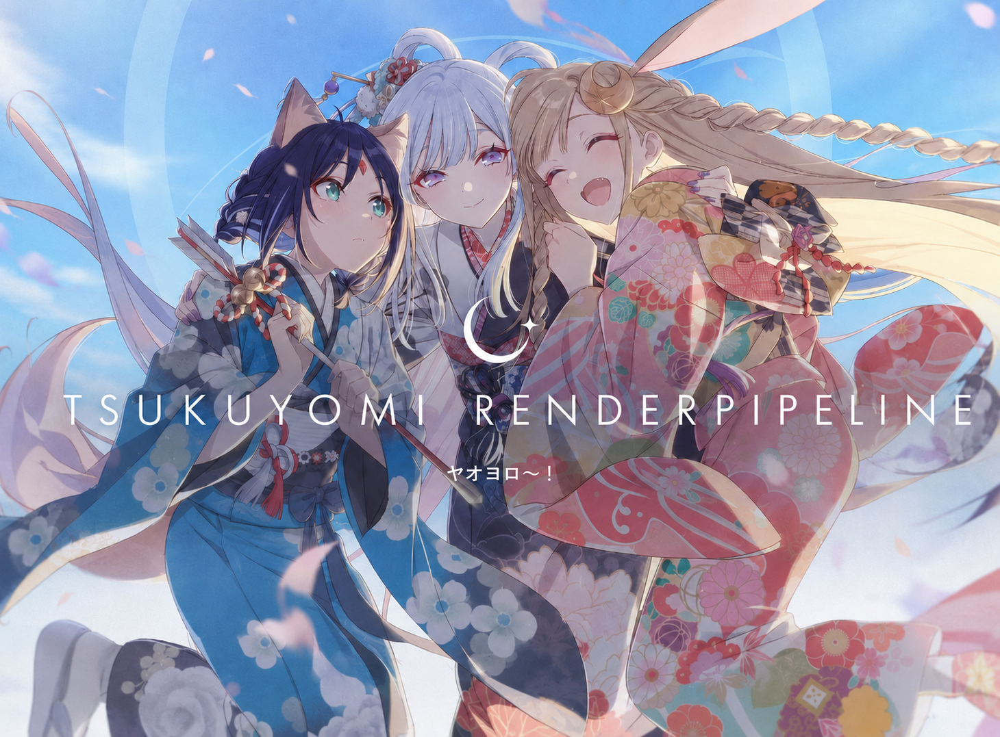

# TsukuyomiRP

TsukuyomiRP is an experimental collection of custom rendering features for Unity's Universal Render Pipeline (URP).

> [!WARNING]
> This package is under active development. APIs and rendering behavior may change between releases.

## Requirements

- Unity 6000.5 with Universal Render Pipeline 17.5, or Unity 6000.6 with Universal Render Pipeline 17.6
- Keep the URP version matched to the Unity Editor; the package retains 17.5.0 as its minimum dependency.
- Git and Git LFS for installation from a Git URL. Native plugins and sample assets are stored in Git LFS.

## Installation

In Unity, open **Window > Package Management > Package Manager**, select **Install package from git URL**, and enter:

```text
https://github.com/kx1125/TsukuyomiRP.git#v0.3.1
```

You can also add the package directly to your project's `Packages/manifest.json`:

```json
{
  "dependencies": {
    "tsukuyomi.render-pipelines.universal": "https://github.com/kx1125/TsukuyomiRP.git#v0.3.1"
  }
}
```

## Profile and Graph Editor

New `TsukuyomiPipelineProfile` assets start empty. Open **Graph Editor** from the Profile Inspector, double-click a rendering stage to add a Pass, and click **Save & Apply**. Expand a stage in the Inspector to edit parameters, toggle Passes or drag them into order. The Graph Editor shows that order with numbered nodes and links.

The Graph Editor refreshes a clean draft when the Profile changes externally. If the draft also has edits, the window keeps them and prompts you to reload before applying.

Each RendererFeature owns its Pass runtime instances and camera resources. Passes prepare their settings in `PrepareRecording` and declare their dependencies and restoration steps; the Feature handles generic scheduling and lifecycle management. New Passes provide their own code and resources and are discovered automatically, without adding effect-specific fields or branches to the framework.

Settings resolve from node defaults, then checked Volume fields, then explicit camera overrides. **Enabled is the master switch:** an absent or disabled node cannot be activated by Volume or camera API overrides.

## Post-processing

Enable **Post Processing** on the camera and add **Bloom**, **Diffusion** or **Tonemapping** to the **BeforePostProcess** stage. The final Uber draw blends the active effects in Profile order. To tune Diffusion, set **Intensity**, **Radius** and **Highlight Limit** on the node or in the **TsukuyomiRP/Postprocessing/Diffusion** Volume override.

## Toon environment materials and object outlines

Assign **TsukuyomiRP/Toon/EnvironmentCommon** to an environment material. The shader exposes toon shadow bands, specular and rim lighting. Its RMOE texture packs roughness, metallic, occlusion and emission mask into the R, G, B and A channels.

For mesh outlines, add **ObjectOutlinePass** to **AfterOpaque** in the Profile Graph Editor and click **Save & Apply**. By default it draws opaque renderers on the selected layers whose material has an `ObjectOutline` LightMode pass. Set **Outline Color** and **Outline Width** on the material. Width is measured in pixels at 1080p. **Mesh Normal** uses the mesh normals. Choose **Vertex Color** for meshes with smooth tangent-space normals encoded in vertex RGB.

Add **TsukuyomiRP/Object Outline** to a Volume to toggle the outline or set **Distance Fade Start** and **Distance Fade End** in world units. With no fade override, the material width applies at every distance.

## SceneScan rendering features

SceneScan provides four independent playback modules and an optional persistent outline. Add their nodes in Graph Editor and edit the settings in the Profile Inspector. All five nodes accept `TsukuyomiRP` Volume overrides.

| Feature | Public Pass | Responsibility |
| --- | --- | --- |
| VoxelTransition | `TsukuyomiVoxelTransitionPass` | Voxel sampling, screen expansion and distortion |
| ScanPostProcess | `TsukuyomiScanPostProcessPass` | Surface scan/grid, reveal, flash, voxel glitch, horizontal glitch and chromatic split |
| XrayRender | `TsukuyomiXrayRenderPass` | Registered renderer masks, private target depth and highlights behind walls |
| SpatialGridRender | `TsukuyomiSpatialGridRenderPass` | World-space lattice points and connecting lines |
| Scene Outline | `SceneOutlinePass` | Persistent scene silhouettes and surface creases, with optional character exclusion |

**Scene Outline** draws when both its Profile node and the camera's **Post Processing** switch are enabled. Attach **Scene Outline Exclude** to a character root to exclude its visible renderers. The other four nodes start on standby. Start playback for a camera with `SetCameraEnabled(camera, true)` or turn on the corresponding Volume's `enable` override. Project code owns timing, curves and presets. Scan, voxel glitch, horizontal glitch and chromatic split have separate switches.

```csharp
TsukuyomiScanPostProcessPass.SetCameraEnabled(camera, true);
TsukuyomiScanPostProcessPass.SetCameraEffectEnabled(camera, ScanPostEffect.ChromaticSplit, false);
// At the end of playback, return to the Volume setting (off by default).
TsukuyomiScanPostProcessPass.ClearCamera(camera);
```

SpatialGridRender can run independently with full coverage; its current Mesh backend remains private so future particle or Compute Shader implementations can retain the public parameter API.

See [Scene effect APIs](Documentation~/SceneEffects.md) for coverage, animation, renderer registration, resource cleanup and execution order, and the [feature development guide](Documentation~/FeatureDevelopmentGuide.md) for custom Pass integration.

## DLSS / FSR3

The unified `Tsukuyomi Upscaler` supports switching between DLSS SR / DLAA and FSR3, with optional DLSS 5 Neural Rendering after post processing.

The Git URL above installs the complete package, including `Plugins` and `ThirdParty/UnityRHI`. Restart Unity after installation so its Windows native plugins preload. Separate `top.kuanmi.*` packages are unnecessary.

## Samples

The **LookDev** sample contains a subway scene configured to demonstrate TsukuyomiRP rendering features.

1. Open **Window > Package Management > Package Manager** and select **TsukuyomiRP**.
2. Open the **Samples** tab and import **LookDev**.
3. In the setup prompt, select **Apply and Open**.

The setup assigns the imported `SampleScene_Asset.asset` to Graphics Settings and the active Quality level, repairs APV Scene GUID references if the sample importer changed them, and opens `LookDev.unity`. If the prompt was dismissed, run **Tools > Tsukuyomi RP > Samples > Setup LookDev Sample**.

The sample render pipeline asset references its included renderer and Tsukuyomi pipeline profile. Applying it changes rendering for the current project, so restore your previous pipeline asset after evaluating the sample if necessary.

## License

This project is licensed under the [MIT License](LICENSE.md).

Bundled native libraries and third-party code retain their respective licenses; see the [third-party notices](ThirdParty/UnityRHI/ThirdPartyNotices.md).
